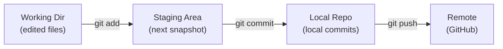
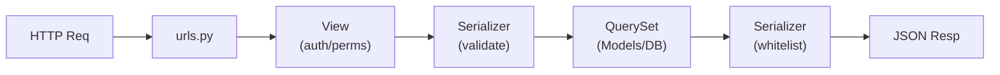
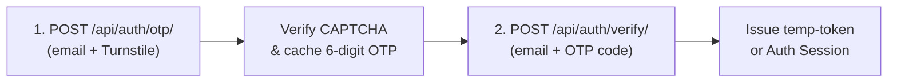
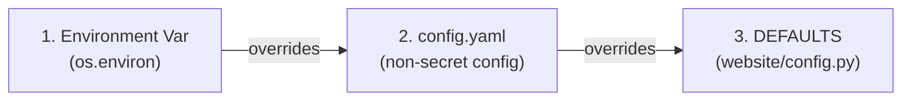
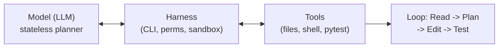

---
title:
  - Tech-JI Volunteer Handbook
author:
  - Tech GC
theme:
  - Copenhagen
date:
  - October 2026
colorlinks: true
linkcolor: .
urlcolor: blue
header-includes: |
  \usepackage{fvextra}
  \usepackage{listings}
  \usepackage{tikz}
  \usetikzlibrary{arrows.meta,positioning,shapes.geometric,calc}
  \usepackage{geometry}
  \geometry{left=0.8cm,right=0.8cm,top=0cm,bottom=1.5cm,headheight=2.25ex,headsep=0pt}
  \setbeamertemplate{navigation symbols}{}
  \DefineVerbatimEnvironment{Highlighting}{Verbatim}{breaklines,breakanywhere,commandchars=\\\{\},fontsize=\scriptsize,xleftmargin=0pt,xrightmargin=0pt}
  \lstset{basicstyle=\ttfamily\scriptsize,frame=single,frameround=tttt,columns=fullflexible,keepspaces=true,showstringspaces=false,backgroundcolor=\color{yellow!20},breaklines=true,breakatwhitespace=false,xleftmargin=2pt,xrightmargin=2pt,aboveskip=2pt,belowskip=2pt}
  \renewcommand{\baselinestretch}{0.95}
  \setbeamertemplate{headline}{\leavevmode\hbox{\begin{beamercolorbox}[wd=\paperwidth,ht=2.25ex,dp=1ex,center]{section in head/foot}\usebeamerfont{section in head/foot}\insertsectionhead\end{beamercolorbox}}\vskip0pt}
  \setbeamertemplate{footline}{\leavevmode\hbox{\begin{beamercolorbox}[wd=.333333\paperwidth,ht=2.25ex,dp=1ex,center]{author in head/foot}\usebeamerfont{author in head/foot}\insertshortauthor\end{beamercolorbox}\begin{beamercolorbox}[wd=.333333\paperwidth,ht=2.25ex,dp=1ex,center]{title in head/foot}\insertshorttitle\end{beamercolorbox}\begin{beamercolorbox}[wd=.333333\paperwidth,ht=2.25ex,dp=1ex,right]{date in head/foot}\usebeamerfont{date in head/foot}\insertshortdate{}\hspace*{2em}\insertframenumber{} / \inserttotalframenumber\hspace*{2ex}\end{beamercolorbox}}\vskip0pt}
---

\tableofcontents

## How to use this handbook

- **One concept per slide.** Read in order before opening your first PR; keep it open as a command reference afterward.
- **Run every command.** Reading terminal commands builds zero muscle memory.
- **Roadmap:** Ch 1--3 cover workflow and team rules; Ch 4--5 cover architecture and testing; Ch 6--7 cover security, privacy, and AI agents.

# 1. Ecosystem & Rules of Engagement

## 1.1 The three production projects

| Repo | Stack | Tool | Branches |
|---|---|---|---|
| `CourseReview` | Django 6, PG 18, Celery | `uv` | `main`, `dev` |
| `CourseFront` | Vue 3.5, Vite 7, Tailwind 4 | `bun` | `main`, `dev` |
| `Handbook` | VitePress 1.6 (Markdown) | `pnpm` | `master`, `dev` |

- **Live API:** `https://api.gcers.org` (`Tech-JI/CourseReview`).
- **Live Handbook:** `https://survive.gcers.org` (`Tech-JI/GCSurvivalHandbook`).
- **Task Board:** `https://cal.gcers.org` (self-hosted Kaneo).

## 1.2 Three traps that catch newcomers

1. **Handbook uses `master`, not `main`.** Merging into `master` triggers immediate deployment with no automated test suite.
2. **`CourseReview/frontend/` is a Git submodule.** Never edit Vue files inside `CourseReview`; make all frontend edits in `CourseFront`.
3. **One repo, one package manager.** Never run `npm` or `pip` directly. Committing a stray `package-lock.json` breaks deterministic builds and will be rejected.

## 1.3 The volunteer progression ladder

| Tier | Scope | Gate |
|---|---|---|
| **Tier 0** | Fix docs, typos, links | `pnpm run docs:build` |
| **Tier 1** | Add unit tests for existing code | New `pytest` tests pass |
| **Tier 2** | Fix a bug test-first (TDD) | Fails first, passes after |
| **Tier 3** | Ship an end-to-end feature | Full suite + design sign-off |

- Everyone starts at **Tier 0 or Tier 1** to master the workflow safely.

## 1.4 The five rules of engagement

1. **Zero secrets in Git.** Never commit keys, tokens, passwords, or student PII.
2. **Never commit on `main`, `master`, or `dev`.** All work happens on a short-lived topic branch.
3. **Never push unverified code.** Run tests or static builds locally before every push.
4. **One PR, one concern.** Do not mix bug fixes, formatting sweeps, and dependency updates.
5. **Align before coding.** Claim the task on Kaneo and post a 3-line plan before writing code.

# 2. Toolchain, Local Setup & Gatekeepers

## 2.1 Four accounts, in order

1. **GitHub account with 2FA enabled.** Use a TOTP app (Bitwarden, 2FAS, Google Authenticator). Compromised accounts threaten production repos.
2. **Tech-JI organization invite.** Accept the invite so you can push topic branches directly without forking.
3. **Kaneo board (`cal.gcers.org`).** Used to claim tasks and track progress across all repos.
4. **Volunteer chat group.** Used for environment troubleshooting, review pings, and private security escalation.

## 2.2 Install the exact toolchain

| Tool | Repo | Install Command |
|---|---|---|
| `uv` | `CourseReview` | `pip install uv` |
| `bun` | `CourseFront` | See installer script below |
| `pnpm` | `Handbook` | `npm install -g pnpm` |
| `gh` | All repos | Install CLI, then `gh auth login` |
| `docker` | `CourseReview` | Docker Desktop or Podman |

```bash
curl -fsSL https://bun.sh/install | bash
uv --version && bun --version && pnpm --version && gh auth status
```

## 2.3 Clone repos & set Git identity

```bash
mkdir -p ~/TechJI && cd ~/TechJI
git clone git@github.com:Tech-JI/CourseReview.git
git clone git@github.com:Tech-JI/CourseFront.git
git clone git@github.com:Tech-JI/GCSurvivalHandbook.git

git config --global user.name "Your Real Name"
git config --global user.email "your_id@sjtu.edu.cn"
git config --global init.defaultBranch main
```

- **SSH vs HTTPS:** `git@github.com:` uses an `ed25519` SSH keypair (see §6.2 for SSH key security); `https://` works via `gh auth login`.
- Never clone into paths with spaces, Chinese characters, or cloud sync (iCloud/OneDrive).

## 2.4 Turn on pre-commit gatekeepers

```bash
cd ~/TechJI/CourseReview && ./run.py hooks
cd ~/TechJI/CourseFront && bunx pre-commit install
cd ~/TechJI/GCSurvivalHandbook && pnpm dlx pre-commit install
```

- **What it enforces:** Blocks direct commits on `main`/`master`, runs `detect-private-key`, and formats staged files.
- **If a hook modifies files:** That is normal. Inspect with `git diff`, run `git add <file>`, and commit again.
- **Hard rule:** Never bypass hooks with `git commit --no-verify` (`-n`).

## 2.5 Bootstrap `CourseReview` locally (1/2)

```bash
cd ~/TechJI/CourseReview
cp .env.example .env       # set a random local SECRET_KEY
./run.py init              # sync Python 3.14 & uv dependencies
./run.py infra up          # start Postgres 18 & Valkey 9 containers
./run.py django migrate    # apply database migrations
./run.py django createsuperuser
./run.py dev               # http://127.0.0.1:8000
```

- Stop containers when finished: `./run.py infra stop`.

## 2.5 `CourseReview` daily CLI commands (2/2)

```bash
./run.py test
./run.py test -- -q
./run.py test -- apps/web/tests/test_review.py -x
./run.py django makemigrations
./run.py hooks
```

- Everything after `--` is forwarded directly to `pytest`.
- **Safety boundary:** Never run `./run.py stack up --mode prod` on your laptop; production orchestration is for deployment servers only.

## 2.6 Bootstrap `CourseFront` & `Handbook`

**`CourseFront` (dev server on `:5173`, proxies `/api` to `:8000`):**

```bash
cd ~/TechJI/CourseFront
cp .env.example .env && bun install
bun run dev
bun run lint && bun run format && bun run build
```

**`GCSurvivalHandbook` (VitePress static site):**

```bash
cd ~/TechJI/GCSurvivalHandbook
pnpm install && pnpm run docs:dev
pnpm run docs:build   # mandatory gate before every PR
```

## 2.7 Six-step environment troubleshooting

1. **Check Git state:** Run `git status` — right branch and clean working tree?
2. **Check lockfiles:** Did an accidental `npm` run create `package-lock.json`? Delete it.
3. **Check containers:** Run `docker ps`. If DB/cache are stopped, run `./run.py infra up`.
4. **Check `.env` & schema:** Confirm `.env` exists and `./run.py django migrate` is up to date.
5. **Clean reinstall:** Remove `.venv` or `node_modules` and re-run `./run.py init` or `bun install`.
6. **Ask with context:** Share OS, exact command, **full text traceback**, and what you tried.

# 3. Git, GitHub & Collaboration Protocol

## 3.1 Kaneo: the source of truth (1/2)

- **Kanban over GitHub:** Kaneo (`cal.gcers.org`) tracks tasks across `Backlog -> To do -> In progress -> Done`.
- **Automated rules:** Opening or merging a GitHub PR moves its linked Kaneo card automatically.
- **Preventing duplicate work:**
  - Card in **In progress** with an assignee? Do not start a competing PR; ask the assignee first.
  - Card in **To do** and unassigned? Claim it before coding.

## 3.1 Issue--Task linking & labels (2/2)

```text
---
Task: lx079z7ifxmxcpffrqbn56xh
```

- **Machine footer:** The `Task: <id>` line at the bottom of an issue body links GitHub to Kaneo. **Never delete it** when editing an issue.
- **Shared label taxonomy:**
  - Type: `bug`, `feat`, `enhancement`, `help wanted`
  - State: `status:to-do`, `status:in-progress`
- Every new issue must carry both a type label and a status label.

## 3.2 Task claiming & 48-hour sync protocol

1. Filter Kaneo to **To do** and choose an unassigned `help wanted` task.
2. Read the entire GitHub issue and all previous comments (rejected approaches are often documented there).
3. Comment with your plan before writing code:
   *"I'd like to take this. Plan: [2--3 lines on files & approach]. Any constraints?"*
4. Assign yourself and move the card to **In progress**.
5. **48-hour stall rule:** If you are blocked or unavailable for >48 hours, post an update in the issue thread or unassign yourself so the task is not deadlocked.

## 3.3 How to file an actionable issue

When you discover a bug or improvement, file a structured issue instead of a vague chat message:

- **Title:** Clear scope prefix, e.g., `[bug] spider fails on empty syllabus table`.
- **Steps to Reproduce:** Exact URL, CLI command, or payload that triggers the problem.
- **Expected vs Actual Behavior:** Include the exact traceback or HTTP status code (with secrets and student PII redacted).
- **Labels:** Attach `bug` or `enhancement` plus `status:to-do`.

## 3.4 Git mental model: four boxes & pointers (1/2)



- `git status` shows which box each file is in. Run it constantly.
- `git diff` compares Working Dir vs Staging; `git diff --staged` shows the exact snapshot that will be committed.
- **Branches are pointers, not folders:** A branch is a movable label pointing to a commit hash. `HEAD` points to your active branch; `origin/dev` is your cached view of GitHub.

## 3.4 Clone vs Fork workflow (2/2)

| Access Level | Workflow |
|---|---|
| **Org member** | Clone repo, push branch to `origin` |
| **Invite pending** | Fork repo, add `upstream`, open PR |
| **Read-only** | Clone official repo, never commit |

```bash
git remote add upstream git@github.com:Tech-JI/CourseReview.git
```

- With org access, **do not fork**—maintaining a fork adds unnecessary sync overhead.

## 3.5 The 8-command contribution loop

```bash
git switch dev && git pull                # 1. sync integration base
git switch -c fix/46-default-key          # 2. create & enter branch
# ... edit code and run local tests ...
git status                                # 3. check modified files
git add -p apps/web/views.py              # 4. stage intentional hunks
git diff --staged                         # 5. audit staged diff
git commit                                # 6. write commit message
git push -u origin fix/46-default-key     # 7. push topic branch
# 8. Open PR on GitHub (base = dev; master for Handbook)
```

- **Branch naming:** `<type>/<issue-id>-<kebab-summary>` (e.g., `fix/46-default-key`, `feat/52-course-filter`). Never use your name or `test2`.

## 3.6 Conventional Commits & atomic staging (1/2)

```text
type(scope): imperative summary under 72 chars

Optional body: explain WHY this approach was chosen and any
constraints, not WHAT lines changed. Wrap at 72 chars.

Refs: #46
```

- **Valid types:** `feat`, `fix`, `docs`, `test`, `refactor`, `perf`, `chore`, `style`, `build`, `ci`.
- **Good:** `fix(auth): reject expired temp tokens on signup`
- **Bad:** `update`, `fix bug`, `wip`, `final2`.

## 3.6 Commit size & interactive staging (2/2)

:::center
**If you cannot describe a commit in one sentence without "and", split it.**
:::

```bash
git add -p apps/web/views.py   # y=stage, n=skip, s=split, e=edit
git restore --staged <file>    # unstage a file without losing edits
```

- Stage hunk-by-hunk with `git add -p` instead of blind `git add .` so debug prints never enter history.
- Keep PRs under ~300 changed lines; put repo-wide formatting in a separate PR.

## 3.7 Pull Request specification (1/2)

A PR is an engineering proposal backed by proof. Include four parts in the description:

1. **What & Why:** 1-paragraph summary plus `Closes #46` (auto-closes issue on merge) or `Refs #29` (links without closing).
2. **How Verified:** Exact test/build commands run and their output (attach screenshots for UI or error-message changes).
3. **Migration / Config Notes:** Explicitly flag any new Django migration (`Requires migrate`), new env var, or breaking API change.
4. **Open Questions & AI Disclosure:** Note edge cases for reviewers and state if an AI agent assisted.

## 3.7 Draft PRs & pre-review amending (2/2)

- **Open a Draft PR early:** If an issue requires architectural choices, open a Draft PR after ~30 lines to validate direction before writing 300 lines.
- **Amending before review starts:**

```bash
git add forgotten_file.py
git commit --amend --no-edit
git push --force-with-lease
```

- `--force-with-lease` refuses to overwrite remote commits if someone else pushed to your branch. **Never use raw `--force`.**

## 3.8 Code review protocol

- **Once review starts, push new commits — do not `force-push`.** Force-pushing during active review breaks GitHub's inline comment anchors and forces reviewers to re-read the entire PR from scratch.
- **Thread hygiene:** Reply to every comment with your reasoning or the fixing commit hash, then click **Resolve conversation**.
- **Never delete a reviewer's comment.**
- **Ask, do not guess:** If a review request is ambiguous, ask in the thread before rewriting code.

## 3.9 Resolving merge conflicts via rebase

```bash
git switch dev && git pull
git switch feat/my-branch
git rebase dev
# edit conflicted file, remove <<<<<<< ======= >>>>>>> markers
git add <resolved-file>
git rebase --continue
git push --force-with-lease
```

- **Panic button:** `git rebase --abort` restores your branch to its exact state before the rebase started. Nothing is lost.
- If a conflict touches logic you did not write, ask the other author before choosing a side.

# 4. Architecture Deep Dive

## 4.1 `CourseReview`: directory map (1/2)

```text
CourseReview/
  run.py              # unified CLI wrapper (use instead of manage.py)
  pyproject.toml      # Python 3.14 & uv lock specification
  config.yaml         # non-secret default settings
  compose.yaml        # db, cache, backend, celery worker/beat
  website/            # settings.py, urls.py, config.py
  apps/
    web/              # courses, reviews, votes, rankings
    auth/             # SJTU OTP, Turnstile CAPTCHA, tokens
    spider/           # ORC, timetable, grade median crawlers
    recommendations/  # course recommendation tasks
    analytics/        # usage & review aggregation tasks
```

## 4.1 Why `./run.py` is mandatory (2/2)

- **Read `docs/` first:** `docs/usage.md`, `docs/config.md`, `docs/auth.md`.
- **Container hostname rewriting:** `.env` points to `postgres://...@db:5432/...` and `redis://cache:6379/0`.
- When you run `./run.py test` or `./run.py dev` on your laptop, `run.py` rewrites `db` and `cache` to `127.0.0.1` in memory for the child process.

> **Warning:** Never manually change `db` or `cache` to `localhost` in `.env`—doing so breaks container-to-container networking.

## 4.2 `CourseReview`: request chain & layers (1/2)



- **URL routing (`website/urls.py`):** `/api/auth/*` -> `apps.auth`, `/api/*` -> `apps.web`, `/spider/*` -> `apps.spider`.
- **Video walkthrough (2025-12-28, 56 min):** Watch the `CourseReview` structure & request-chain recording at <https://sjtu.feishu.cn/minutes/obcnxdu8kam1bvu7eu6oiaq7>.

## 4.2 Layer responsibilities & ORM rules (2/2)

- **Views (`views.py`):** Handle HTTP methods, status codes, and object-level permission checks. Keep heavy business queries out of views.
- **Serializers (`serializers.py`):** Validate input payloads and strictly whitelist output fields (`fields = ["id", "rating", ...]`).
- **ORM QuerySets (`models.py`):** Avoid $N+1$ query bottlenecks on list endpoints by chaining `select_related()` (foreign keys) and `prefetch_related()` (many-to-many / reverse lookups).

## 4.3 `CourseReview`: two-stage authentication



- **Why two tokens exist:** `temp-token` grants temporary permission solely to complete account registration; it cannot access course or review APIs.
- All OTP lifetimes and rate limits are configured via `AUTH.*` keys in `config.yaml` and enforced via Valkey TTLs.

## 4.4 `CourseReview`: Celery Beat & background jobs

- **Nightly schedule:** ORC crawl (`01:00`), timetable (`01:30`), grade medians (`02:00`), term check (`03:00`), syllabus purge (`04:00`).
- **Weekly schedule:** Analytics (Monday), recommendations (Tuesday).
- **Two rules for background tasks:**
  1. **Idempotency:** Tasks must be safe to run twice (`update_or_create`), because network retries happen.
  2. **Single Beat instance:** Production runs **strictly one** `celery beat` scheduler; starting a second beat sends duplicate emails to real students.

## 4.5 `CourseReview`: database migration rules

When you modify `models.py`, generate a migration with `./run.py django makemigrations`:

1. **Never edit or delete an already-merged migration.** Once a migration is in `dev` or `main`, write a new migration to alter it.
2. **Separate schema from data:** Do not mix `AddField`/`AlterField` with large `RunPython` data backfills in the same migration file.
3. **Inspect before committing:** Read the generated `migrations/00xx_*.py` file to verify index names, `on_delete` rules, and nullable defaults.

## 4.6 `CourseFront`: directory & proxy topology (1/2)

```text
CourseFront/
  vite.config.js    # dev proxy: /api -> http://localhost:8000
  worker.js         # prod Cloudflare Worker proxy -> api.gcers.org
  src/
    views/          # route pages (Home, CourseDetail, Login)
    components/     # reusable UI blocks (CourseList, ReviewCard)
    composables/    # stateful logic & API calls (useAuth, useCourses)
    utils/          # api.js, auth.js, sanitize.js
```

- Point local frontend at live API when needed: `VITE_PROXY_TARGET=https://api.gcers.org bun run dev`.

## 4.6 `CourseFront`: strict 3-layer separation (2/2)

- **`utils/api.js`:** The **only** module allowed to configure `axios`, attach auth tokens, and intercept HTTP errors.
- **`composables/`:** Encapsulate reactive state (`ref`, `computed`) and call `utils/api.js`.
- **`views/` & `components/`:** Pure presentation and user interaction.

> **Architecture rule (Issue #7):** Never import `axios` or hardcode `/api/...` URLs directly inside a `.vue` component.

## 4.7 `GCSurvivalHandbook`: bilingual VitePress (1/2)

1. Create `/<slug>.md` (Chinese default) and `/en/<slug>.md` (English mirror).
2. Register the route in `.vitepress/config.mts` under **both** `nav` and `sidebar` for **both** `zh-CN` and `en`.
3. Use extensionless links (`/study`, never `/study.html`) to match `cleanUrls: true`.
4. Verify with `pnpm run docs:build`—broken markdown links or syntax errors fail the static build.

## 4.7 `GCSurvivalHandbook`: parity & CI gate (2/2)

- **Existing pages:** `index`, `study`, `platform`, `organization`, `WP`, `location`, `wksp`, `extra`, plus `/en/` mirrors.
- **Bilingual parity rule:** When updating policy facts, deadlines, or links in Chinese, update the English mirror in the same PR (or document the gap in the PR description).
- **Local build requirement:** Until GitHub Actions CI is added to Handbook, you are the gate—run `pnpm run docs:build` before every push.

# 5. Testing, CI & Verification

## 5.1 Pre-PR verification checklist

- [ ] Working on a topic branch (`feat/...` or `fix/...`), never `main`/`master`.
- [ ] Pre-commit hooks and linters pass (`./run.py hooks` / `bun run lint`).
- [ ] Bug fix or feature includes a test that **fails without your change**.
- [ ] Full local test or build suite passes (`./run.py test` / `docs:build`).
- [ ] `git diff --staged` has zero secrets, stray lockfiles, or debug prints.
- [ ] PR description states **What**, **Why (`Closes #N`)**, and **How verified**.

:::center
**A PR is valid when a reviewer can approve it without asking "Did you test this?"**
:::

## 5.2 `pytest` & fixtures in `CourseReview`

| Fixture (`conftest.py`) | What It Provides |
|---|---|
| `base_client` | Unauthenticated test client |
| `user`, `auth_client` | Student user + authenticated client |
| `staff_user`, `staff_client` | Staff user + authenticated client |
| `course`, `course_batch` | Courses built via `factories.py` |
| `eager_media` | Immediate media handling in tests |

- `--reuse-db` is enabled by default in `pyproject.toml` for speed.
- Changed a model or migration? Pass `--create-db` once: `./run.py test -- --create-db`.

## 5.3 Test-Driven Development: fail first (1/2)

**Worked example (Issue #46):** Refuse startup when `SECRET_KEY` is the shipped insecure default.

```python
import pytest
from django.core.exceptions import ImproperlyConfigured

DEFAULT_KEY = "django-insecure-my-local-dev-secret-key"

def test_startup_rejects_default_secret_key(monkeypatch):
    monkeypatch.setenv("SECRET_KEY", DEFAULT_KEY)
    with pytest.raises(ImproperlyConfigured, match="SECRET_KEY"):
        from website import config
        config.validate_secret_key()
```

## 5.3 The Red -> Green -> Regression loop (2/2)

```bash
# 1. RED: run before writing the fix — must FAIL
./run.py test -- apps/web/tests/test_secret_key_guard.py

# 2. GREEN: implement guard in website/config.py, then re-run
./run.py test -- apps/web/tests/test_secret_key_guard.py

# 3. REGRESSION: run full suite to prove nothing else broke
./run.py test
```

> **Tip:** A test that passes before you write the implementation is a decoration, not a test.

## 5.4 Properties of a high-signal test

- **Descriptive name:** `test_non_author_cannot_delete_review`, never `test_review_2`.
- **Arrange / Act / Assert:** Visually separate setup, single endpoint/function call, and assertions.
- **Test the contract, not internals:** Assert HTTP status codes (`403`, `201`), response JSON keys, and database state (`Review.objects.count()`).
- **Hermetic & deterministic:** Never make real network requests or rely on wall-clock time; mock external boundaries with `monkeypatch`.

## 5.5 How GitHub Actions CI runs your code

`.github/workflows/pytest.yml` triggers on every push and PR to `dev` and `main`:

1. Boots clean `postgres:18-alpine` and `valkey/valkey:9-alpine` containers.
2. Sets dummy credentials (`TURNSTILE_SECRET_KEY: dummy0`, `QUEST__SIGNUP__API_KEY: dummy1`).
3. Runs `uv sync --frozen --group dev` (fails if `uv.lock` is out of sync with `pyproject.toml`).
4. Runs `python run.py test`.

- Never touch maintainer workflows (`build-image.yml`, `bot.yaml`) without explicit instruction.

## 5.6 Debugging failing tests (local vs CI)

1. Read the **bottom traceback frame** and assertion line first—not the top of the log.
2. Isolate the failing test: `./run.py test -- path/to/test.py::test_name -x -vv`.
3. **Passes locally, fails in CI?** Your code depends on local state: an unmocked `.env` key, stale DB rows (`--create-db`), or dict/query ordering (always add `.order_by()` on QuerySets).
4. `git stash` your changes and re-run to check if `dev` was already broken.
5. **Never delete, weaken, or `@pytest.mark.skip` a test** just to make CI green.

# 6. Security, Secrets & Data Privacy

## 6.1 Configuration priority & secret storage



- **Nested lookup:** Double underscores map to nested keys (`QUEST__SIGNUP__API_KEY` -> `QUEST.SIGNUP.API_KEY`).
- **What is a secret:** `SECRET_KEY`, `DATABASE__URL` passwords, `TURNSTILE_SECRET_KEY`, `QUEST__*__API_KEY`, LLM API keys, Cloudflare tunnel tokens, and SSH private keys.
- **Storage rule:** `DEFAULTS` in `website/config.py` sets every secret to `None`. Commit `.env.example` with placeholders (`dummy0`); keep real `.env` files strictly local and ignored by Git.

## 6.2 SSH key security: public lock vs. private key

```bash
ssh-keygen -t ed25519 -C "your_id@sjtu.edu.cn"   # set a passphrase!
chmod 600 ~/.ssh/id_ed25519                      # owner read/write only
cat ~/.ssh/id_ed25519.pub                        # SAFE: upload to GitHub
```

- **Public key (`id_ed25519.pub`):** Acts as a *padlock*. Safe to paste into GitHub Settings -> SSH Keys.
- **Private key (`id_ed25519`, starts with `BEGIN OPENSSH PRIVATE KEY`):** Acts as your *physical key*. **Never** copy it out of `~/.ssh/`, **never** commit it, send it in chat, or back it up to unencrypted cloud drives.
- **Hard rules:** Always protect private keys with a passphrase, never enable `ForwardAgent yes` on untrusted servers, and immediately delete the key from GitHub if your laptop is lost or a key leaks.

## 6.3 Backend security: fail-closed & IDOR (1/2)

```python
# BAD: insecure fallback + missing ownership check (IDOR bug)
SECRET_KEY = os.getenv("SECRET_KEY", "dev-secret")
def delete_review(request, pk):
    Review.objects.filter(pk=pk).delete()  # deletes anyone's review!

# GOOD: fail-closed secret + strict ownership filter
if not SECRET_KEY or SECRET_KEY.startswith("django-insecure"):
    raise ImproperlyConfigured("Valid SECRET_KEY required")
def delete_review(request, pk):
    review = get_object_or_404(Review, pk=pk, author=request.user)
```

## 6.3 API serialization & logging rules (2/2)

- **Explicit serializer whitelists:** Never set `fields = "__all__"` on `User` or auth models; explicitly list public fields so email hashes, tokens, and internal flags never leak in API responses.
- **Never log credentials or raw request bodies:**
  - Bad: `logger.info(f"Auth payload: {request.data}")` (writes OTP codes or passwords to disk logs).
  - Good: Log only the action name, HTTP status, and non-sensitive object ID.

## 6.4 Frontend XSS & public bundle rules

- **Always sanitize dynamic HTML (`CourseFront`):** Course reviews and markdown text are untrusted user input. Never bind raw content to `v-html` without sanitizing through `src/utils/sanitize.js` (DOMPurify).
- **Client env vars are public:** Every `VITE_*` variable in `CourseFront` is compiled directly into the public JavaScript bundle sent to browsers.
- **Public vs Secret keys:** A Turnstile *site* key may live in frontend config, but `TURNSTILE_SECRET_KEY` must remain strictly on the backend.

## 6.5 The 20-second pre-push secret check

Run this check before every `git push`:

```bash
git diff origin/dev...HEAD \
  | grep -inE "secret|token|api_key|password|PRIVATE KEY"
git status --short
```

**Four rules of secret hygiene:**

1. **Never commit it** — not in `.env`, tests, comments, or terminal screenshots.
2. **Never print it** — print the variable *name* (`Missing SECRET_KEY`), never its value.
3. **Never reuse it** — local uses random keys, CI uses `dummy0`, prod stays on the server.
4. **Never name it vaguely** — use explicit names (`TURNSTILE_SECRET_KEY`), not `KEY2`.

## 6.6 Incident response: if you leak a secret

1. **Alert a maintainer privately** in the chat group within minutes—send the repo, branch, and commit hash.
2. **Revoke and rotate immediately** at the provider (or delete the SSH key on GitHub). Pushing a new commit that deletes the line does **not** un-leak the secret; bots scrape public pushes in seconds and the key remains in Git history.
3. **History cleanup:** A maintainer will rotate the credential and rewrite history if required.

:::center
**Reporting a leak fast is a sign of engineering maturity, not incompetence.**
:::

## 6.7 Student data privacy & scraping boundaries

- **Never copy production data to your laptop:** Do not download production DB dumps, `.env.production`, or real user tables. Use `factories.py` to generate synthetic local data.
- **Never commit real scraped data or PII:** Fixtures and tests must never contain real SJTU student IDs, names, emails, real scraped course reviews, or copyrighted syllabus PDFs.
- **Redact screenshots and logs:** Blur or crop names, email addresses, and cookies before posting screenshots or logs in GitHub Issues or PRs.
- **Prod-only bugs:** If a bug only reproduces on real data, document the steps and hand it to a maintainer.

# 7. AI-Assisted Engineering (Vibe Coding)

## 7.1 Anatomy of a coding agent



- **Stateless loop:** The agent only knows what the harness feeds back from tool output. Whatever it has not read, it guesses.
- **Read `AGENTS.md` / `CLAUDE.md` first:** Project memory files define repo commands and forbidden paths. Read them before prompting, and never put secrets in them.

## 7.2 Permission modes (1/2)

| Mode | Agent Capabilities | When to Use |
|---|---|---|
| **Read-only** | Read files, search, propose diffs | Exploring new code |
| **Ask-first** | Every edit & shell command asks | **Default for greenhands** |
| **Auto-edit** | Edits files; shell asks approval | Scoped tasks once familiar |
| **Full-auto** | Runs anything without asking | **Throwaway VM only** |

- Refuse any shell command you cannot read; ask the agent to explain it first.

## 7.2 Sandbox & human-gated actions (2/2)

- **Always enable the OS sandbox:** Restrict writable directories to the current repository and block unauthorized network access.
- **Never run full-auto on a machine holding real `.env` files, `~/.ssh` private keys, or logged-in cloud CLIs.**
- **Human-gated commands:** A human must manually review and approve `git push`, `git rebase`, `rm -rf`, dependency installs, and database migrations.

## 7.3 Shell inheritance & prompt injection defense

- **Agents inherit your shell environment:** Exported variables (`export API_KEY=...`), `~/.ssh/`, and local `.env` files are readable by un-sandboxed agent tools.
- **Use dummy secrets with agents:** Keep `dummy0` / `dummy1` in your local `.env` (same as CI) during agent sessions, and never paste real keys or student data into a prompt.
- **Beware of prompt injection:** Scraped web pages or untrusted issue text can contain hidden instructions telling the agent to exfiltrate files or run commands.
- **MCP boundary:** Never connect an agent to the Kaneo MCP server or GitHub write tokens unless configured by a maintainer.

## 7.4 The 5-part prompt template

1. **Goal & Non-goals:** *"Solve Issue #37 (expired token returns 401). Do not touch `apps/web/`."*
2. **Repo Context:** *"Read `apps/auth/views.py` and `website/config.py`."*
3. **Hard Constraints:** *"Use `./run.py test`, no new dependencies, keep API schema unchanged."*
4. **Verification Gate:** *"Write a failing test first, run `./run.py test`, and paste the output."*
5. **Plan Before Code:** *"For changes >30 lines, list 5 bullets and touched files; wait for my approval."*

## 7.5 The iron rule of ownership

```text
1. SCOPE    Pick one claimed issue; write down what is out of scope
2. PROMPT   Use the 5-part template; approve the plan before code edits
3. AUDIT    Read every single line of git diff yourself
4. VERIFY   Run ./run.py test (or docs:build) in your own terminal
5. OWN      Rewrite any line you cannot explain to a reviewer
```

- **Disclose AI usage:** Mention agent assistance in your PR description so reviewers know where to focus.
- **Never let an agent open PRs, comment on issues, or reply to reviews.**
- **Rule:** *Never submit code you cannot explain line-by-line. "The AI wrote it" is not an engineering defense.*

## Curated learning resources: Git & walkthrough (1/2)

- **`CourseReview` Architecture Recording (56 min):** [2025-12-28 Feishu Recording](https://sjtu.feishu.cn/minutes/obcnxdu8kam1bvu7eu6oiaq7) — walks through `urls.py`, views, querysets, and serializers step by step.
- **Interactive Git Sandbox:** [Learn Git Branching](https://learngitbranching.js.org/) — visual browser game for practicing `switch`, `rebase`, and branch pointers.
- **MIT Missing Semester (Git):** [Version Control Lecture Notes](https://missing.csail.mit.edu/2020/version-control/) & [YouTube Lecture](https://www.youtube.com/watch?v=2sjqTHE0zok) — explains Git's internal data model.
- **Runoob Git Quickstart:** [Runoob Git Tutorial](https://www.runoob.com/git/git-tutorial.html) — concise Chinese lookup for everyday Git commands.

## Curated learning resources: stack tutorials (2/2)

- **Python 3 & Django (`CourseReview`):**
  - Quickstart (Chinese): [Runoob Python 3](https://www.runoob.com/python3/python3-tutorial.html) & [Runoob Django Tutorial](https://www.runoob.com/django/django-tutorial.html)
  - Official reference: [Django 6 Documentation](https://docs.djangoproject.com/en/6.1/)
- **Vue 3 (`CourseFront`):**
  - Quickstart (Chinese): [Runoob Vue 3 Tutorial](https://www.runoob.com/vue3/vue3-tutorial.html)
  - Official reference: [Vue.js Guide](https://vuejs.org/guide/introduction.html)
- **VitePress (`GCSurvivalHandbook`):**
  - Official reference: [VitePress Getting Started](https://vitepress.dev/guide/getting-started) & [Markdown Extensions](https://vitepress.dev/guide/markdown)

## Where to get help

- **Volunteer chat group:** Toolchain errors, container hiccups, and quick *"Is this expected?"* questions.
- **GitHub Issue / Draft PR comments:** Scope clarifications, architectural trade-offs, and review discussions (public and searchable).
- **Direct message to a maintainer:** Secret leaks, production incidents, security vulnerabilities, or destructive migrations.

:::center
**A clear question costs two minutes. Guessing wrong costs a week.**
:::
